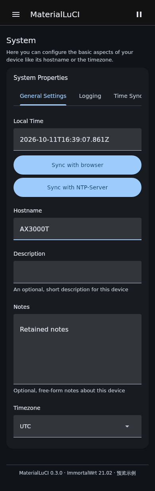
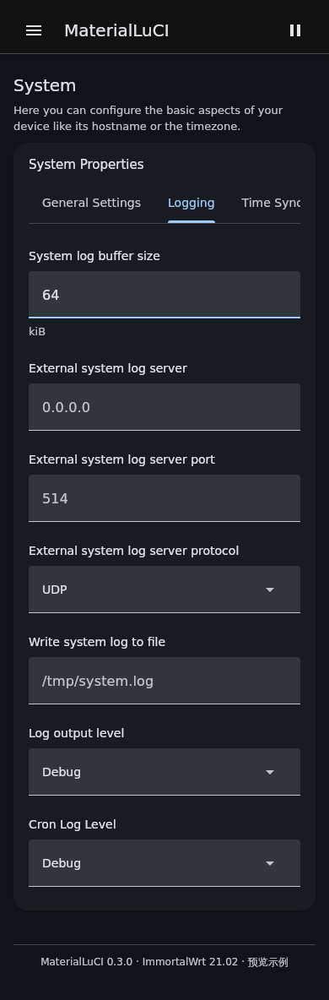
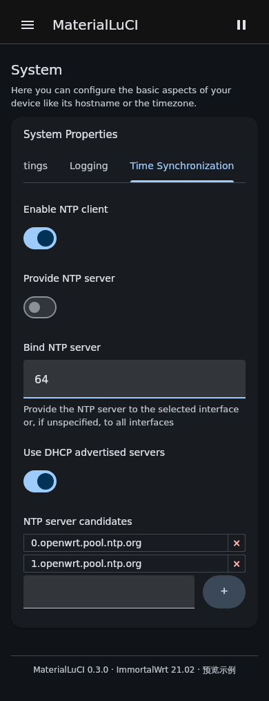
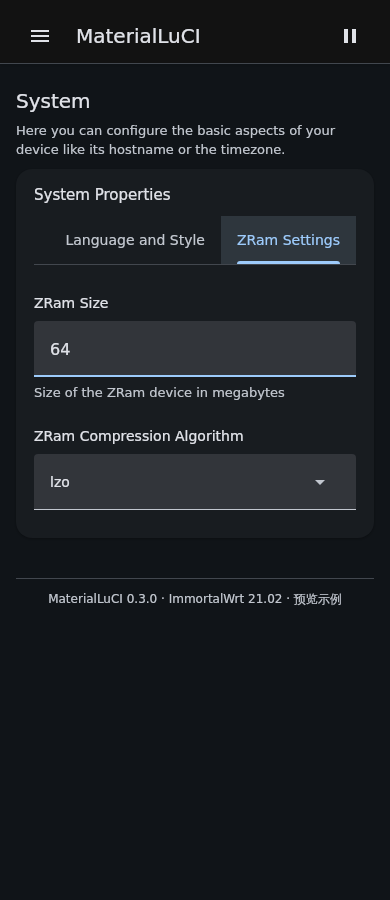
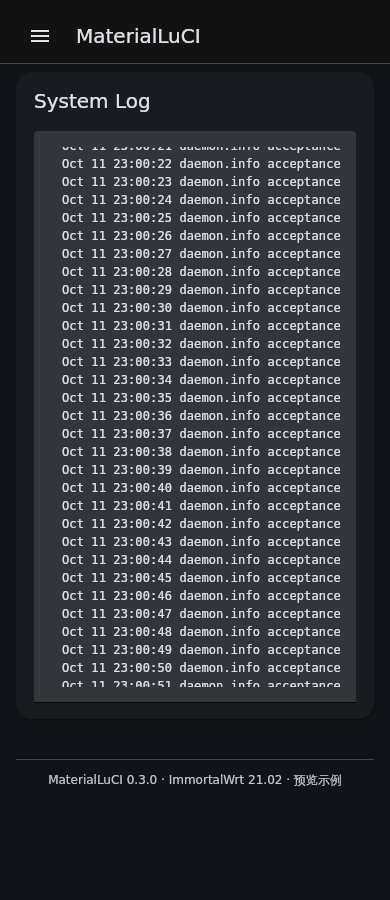
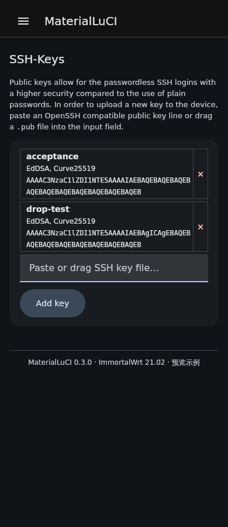
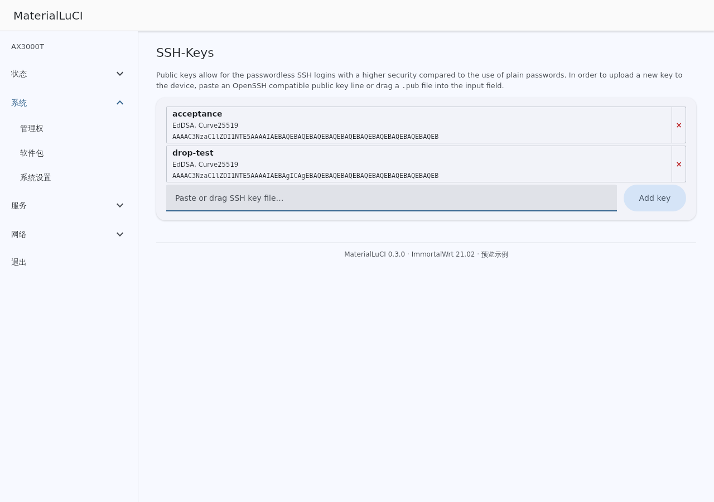
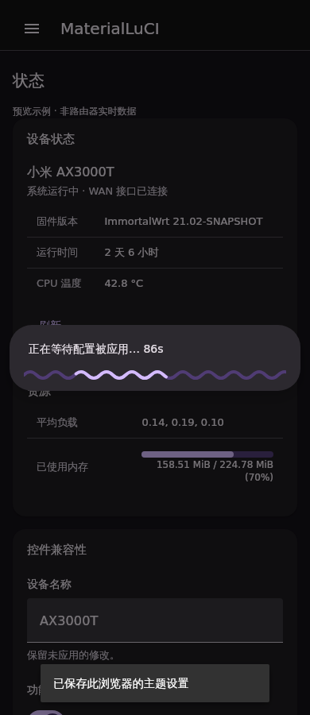
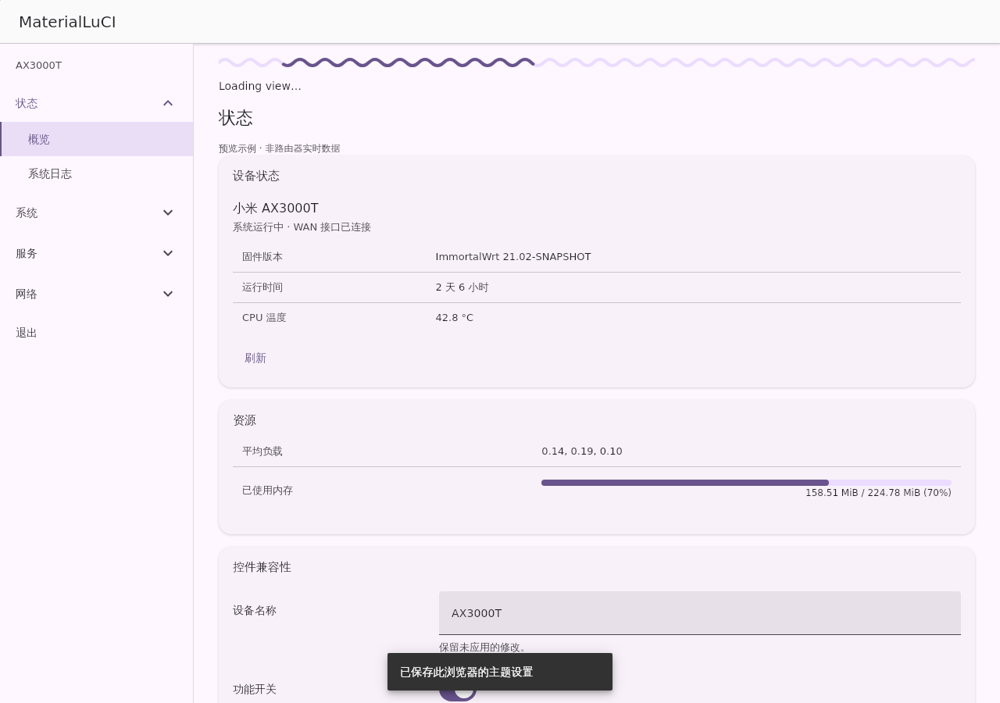

# MaterialLuCI M3E 0.3.0-12 修复与验证报告

本报告对应 feature/m3e-theme 的已通过安装包 Actions 产物，源码与安装包提交为 53ae6ddf…；后续仅提交只读产物复核流程、截图和审计文档，主题代码未再修改。已实际远程审计、修改并运行构建；没有本地克隆、编辑或编译项目。归档 Classic 分支及 main 未修改。

**验收状态：自动化与最终资源截图已验证的部分见下文；真机持续上滑的唯一触发链尚未确定，不能宣布全部真机问题已修复。**

## 基线与交付身份

- 修改基线：4d5ede5c164fbf3791d5296d36cfc2f1e3085cb2，0.3.0-11，Actions 38151004295。首次核实分支 HEAD 时没有更新的后续提交。
- 原失败 IPK SHA256：f7108a1087ab36961b89507ff7d02603535f1258c40c05d2faf3fb7b630ce2f1。下载用户指定的 Actions 安装包，只读检查其 build.json，确认 commit/run/cache 分别为 4d5ede5c… / 38151004295 / 0.3.0-11-4d5ede5c164f；压缩后的 startup.js 仍明确为 design 默认 classic。Material Web、M3 palette、MDC controls/textfield 的 bundle 哈希与候选包相同，性能比较的相同依赖假设得到产物验证。
- 最终提交：53ae6ddfdea1de8e8806ee626059e155bc8b6c39
- 安装包：luci-theme-materialluci_0.3.0-12_aarch64_cortex-a53.ipk
- Actions：https://github.com/Pew2018/MaterialLuCI/actions/runs/38155572776
- IPK SHA256：c0d64b79b228eacf23453b4e5eacd2ff47c493c4cecb3436a8a87b194f835ef5
- 资源构建标识：0.3.0-12-53ae6ddfdea1
- package-audit.json、assets.sha256 和构建内 build.json 提供模板、脚本、CSS 的身份与哈希。它们证明本次产物身份，**不证明旧真机已经加载哪个文件**。

已读取并复核提供的九张截图。截图页脚显示 ImmortalWrt 21.02-SNAPSHOT r20651-02fff2aebc；没有获得路由器实时 DOM、资源响应哈希、Safari 时间线及该固件的精确 LuCI 源码版本。没有将问题归因于缓存。

## 确认的问题、触发链与修复

| 项目 | 代码证据与触发链 | 修复及证据边界 |
| --- | --- | --- |
| 系统布局 | base.css 用 height:0 / opacity:0 隐藏原生标签面板；之前稳定布局规则仅在 design-m3.css 的 M3E 选择器下生效。缺省 Classic 或 palette 回退时不使用这些规则。textarea 包装层原先 align-items:stretch、原字段 height:auto，存在跨浏览器尺寸耦合。 | cascade.css 对非活动面板 display:none，活动面板 height:auto/min-height:0；textarea 非拉伸、flex:none 和 border-box。没有锁住文档高度、禁用滚动或强制滚回顶部。这些是确定的样式缺口；尚不能证明它们就是截图真机持续上滑的唯一根因。 |
| SSH 输入行及长文本 | 21.02 的真实 renderer 是 .cbi-dynlist > .add-item > INPUT + BUTTON。原生 renderKeys 依赖列表末尾仍为 .add-item。独立列表旧 width:auto 会挤压输入；首轮截图又暴露有效密钥的长 base64 溢出，旧断言只检查输入行。 | 列表 width:100%/min-width:0，输入弹性可用宽度，按钮 min-height:48px/min-width:112px，手机换行；仅对 .item[data-key] 的 strong/small/code 换行。未移动原节点、改写 decoder、Enter、FileReader/drop、fs.write 或删除伪元素事件目标。增加有效密钥后的文档和项目溢出检查。 |
| 等待样式自动接入 | startup.js 的缺省风格原为 Classic，所以安装 M3E 分支不代表启用 M3E。已有等待组件按 activeDesign 选择波浪或 MDC 直条。旧系统测试都强制 M3E，漏掉缺省路径。 | 未保存偏好时现在默认 M3E；显式保存的 Classic 保留。requestedDesign/designFallback 暴露 palette 回退状态。通过实际 LuCI View.__init__ 与 changes.displayStatus 的结构变化自动挂载，倒计时保留同一组件。仍未执行真机 ubus apply/reconnect。 |
| 全页扫描与观察器 | extras.js 收到无关新增元素后 enhance(document)，重新查询所有 select、菜单及 tooltip，并对相同提示文本重复赋值；轮询/插入 DOM 可触发这些重复工作。每个 M3 switch/selection/ripple 还各自安装了 body disabled observer。文本节点过滤意味着这不是已证明的无限反馈循环。 | extras.js 值相同不写入，排除装饰子树，只处理发生变化的最小根，requestAnimationFrame 合并；components.js/feedback.js 共享状态观察器，只同步受影响的原控件；app.js 合并嵌套待处理根；wait.js 替换 overlay 时断开旧 modal observer/scroll listener。实测性能数字见后。 |
| 控件覆盖 | 导入 Material Web 并不等于全部 LuCI 原控件已迁移；native buttons、富下拉、动态列表和文件业务节点仍保留。 | 下表按实际运行来源列出，没有把 CSS 外观或导入未使用的 md-linear-progress 报成官方组件迁移。 |

新增有效密钥内容溢出断言在 Actions 38154906694 真实失败；CSS 漏提交随后已修正并远程重读确认。最终通过状态必须对应下述最新产物，不能引用首轮通过掩盖这个失败。

完整代码证据：
https://github.com/Pew2018/MaterialLuCI/blob/53ae6ddfdea1de8e8806ee626059e155bc8b6c39/docs/m3e-device-audit-0.3.0-12.md

## 控件覆盖与来源

| 控件 | 实际来源 | 分类与限制 |
| --- | --- | --- |
| 主题外观页面 outlined/text buttons | Google Material Web 2.5，md-outlined-button / md-text-button | 官方 Web，已经实际使用；并非所有原生 LuCI 操作按钮 |
| 布尔开关 | md-switch，通过保留原 input 的适配器 | 官方 Web；注册不可用时使用 MDC switch 回退 |
| 适合适配的复选框、单选框 | md-checkbox / md-radio | 官方 Web；富下拉及列表自身拥有的原选择项保留 LuCI |
| 原生操作按钮、图标按钮、侧边栏反馈 | M3 下 md-ripple；Classic 下 MDC foundation | 官方 Web 涟漪或 MDC 交互；按钮本体多数仍原生 LuCI 加主题尺寸/状态样式 |
| 文本、密码、数字及 textarea | MDCTextField + 主题 M3 表面 | MDC 交互 + M3 外观，不是官方 Material Web textfield |
| 普通 select | MDCSelect/MDCMenu + 原 select | MDC 交互；multiple/optgroup/富 LuCI 下拉有兼容限制 |
| 标签页、LuCI 富下拉、动态列表 | 原 LuCI + 主题样式 | 未迁移为官方 Web 控件，保留节点和原业务 |
| tooltip、通知、弹窗 | MDC tooltip/snackbar/dialog 适配器 | MDC 交互 + 主题外观，保留 LuCI modal 子节点顺序与关闭语义 |
| 不确定时长的等待/视图进度 | 主题 SVG Expressive 适配组件 | 主题自行实现；持续动画且无随机百分比，不称 Google 官方 Web 组件 |
| 确定进度条 | 原 LuCI 数值与主题 CSS | 未迁移官方 Web，保留真实进度 |
| 文件选择、上传、表单底部保存/应用/重置、危险操作 | 原节点、原业务事件 + 主题样式/反馈 | 未迁移官方 Web；没有替代浏览器文件选择器、上传或 RPC 逻辑 |

查阅的官方资料：

- https://m3.material.io/components/progress-indicators/overview
- https://github.com/material-components/material-web/blob/v2.5.0/progress/internal/linear-progress.ts
- https://github.com/material-components/material-web/blob/v2.5.0/ripple/internal/ripple.ts
- https://github.com/material-components/material-components-android/blob/master/docs/components/ProgressIndicator.md

Material Web 的 md-linear-progress 是普通 M3 线性进度，不是 Expressive 波浪条。Android 的 wavy 组件作为设计与来源参考；本项目 SVG 是主题网页适配实现，不声称为官方 Web 移植。官方 md-ripple 的触摸识别有 150ms 延迟以区分滑动，鼠标路径立即开始；没有移除这项必要判断。

## 实际测试与性能结果

- 构建、语法、安装包身份/全部资源哈希、18 套配色角色与对比度检查通过。
- Chromium 和 Playwright WebKit 的手机/桌面、浅色/深色完整原回归通过；减少动态效果、M3 bundle/palette 回退也通过。
- 10 个页面配置 × 4 个系统标签页，共 40 个持续记录，每个至少 30 秒，编辑字段保留焦点，包含真实定时 poll、wheel、resize/visualViewport 通知，并再次反复切换。文档高度最大变化 0px，滚动位置最大变化 0px，textarea 高度稳定。
- 原 SSH renderer 的无效/有效/重复密钥、回车/按钮/文件拖放、0600 写入模式、只读 drop 阻止、有效密钥后页面与列表项无溢出均通过。
- 系统 Logging 标签页和状态 syslog renderer 分开检查；后者只读 textarea 滚动前后尺寸稳定。
- 真实 LuCI View.__init__ / changes.displayStatus 自动观察接入，倒计时不重建波浪节点，关闭/完成后移除，减少动态效果时停止动画。
- 第二个只读产物复核 Actions 也通过：[产物复核](https://github.com/Pew2018/MaterialLuCI/actions/runs/38157324595)，实际解包确认 SSH wrap CSS 和 IPK SHA256，而非仅检查仓库文件。
- LuCI 源码来自 OpenWrt 21.02 固定 SHA e4c46338b196e486a88b1a75b78e283708c82bc4。**系统测试将 NetworkSelect mock 为 form.Value，以避免网络发现 RPC；因此该字段不是原富下拉 DOM，不能用本次系统测试宣称该网络字段已完成真实结构兼容验收。** 其他富下拉在原回归中另有覆盖；精确 ImmortalWrt fork、真实 RPC 与设备权限场景仍待验证。

性能比较使用失败提交 4d5ede5c 的 JS/CSS presentation assets，以及相同的已编译依赖。页面稳定后，在 100ms 的受控 DOM tick 下执行滚动，统计 Document.querySelectorAll 的全页扫描、MutationObserver 回调/记录、长任务和 rAF 帧间隔。它不是设备 CPU benchmark，也不统计所有 Element 查询或强制布局。

| 指标 | 失败提交资源 | 修复资源 |
| --- | ---: | ---: |
| 全页 Document.querySelectorAll 扫描 | 93 | 0 |
| 该扫描累计耗时 | 6.2ms | 0.0ms |
| MutationObserver 记录 | 1178 | 434 |
| 观察器回调 | 403 | 217 |
| 检测到的长任务 | 0 | 0 |
| P95 帧间隔 | 16.8ms | 16.7ms |
| 最大帧间隔 | 16.8ms | 16.8ms |

减少了全页扫描和观察器工作；两版均未出现长任务，帧间隔几乎相同，**不能把这组数据写成真机流畅性已改善或已修复**。Chromium 原生触摸手势滚动 135px，没有启动额外涟漪或业务回调。两引擎探针各执行 4 次反馈与 4 次原按钮回调，全部 target 正确；实例/状态订阅均从 53/53 恢复到 53/53。鼠标及触摸 tap 的观测动画调用延迟分别约为 Chromium 0.4ms、WebKit 1ms；这是计数探针，不能代表全部控件与实际设备延迟。原始结果见 [JSON](m3e-0.3.0-12/evidence.json)。

涟漪检查通过自动 DOM 增强，使用原生鼠标、Enter、Space、touchscreen tap，检查每次只执行一次原按钮回调且 target 仍为原按钮；取消序列不启动反馈，禁用状态不执行回调，移除探针后实例/状态订阅数量恢复。Chromium 使用 CDP 原生触摸滚动；WebKit 的滚动取消仅合成 PointerEvent，不能替代真机手势。实际反馈动画调用与延迟计数见 *-ripple.json，未仅凭 running 状态判定流畅。

保留原回归测试：字段值/原生提交、验证、依赖、fieldset 禁用恢复、节点及兄弟关系、弹窗生命周期、键盘、文件表单、刷新/菜单/主题个性化设置。测试数据与写入为明确 mock；没有执行真实路由器写入或完整配置应用重连。

## 最终截图复核

### 系统常规设置：notes 正常高度、字段与按钮无重叠

### 系统 Logging 标签：原字段完整、与状态日志分开

### 时间同步：开关与原动态列表；NetworkSelect 字段存在上述 mock 限制

### zram 标签：输入/选择器及页脚稳定

### 状态 System Log：独立只读 textarea，可内部滚动

### SSH 手机：两条有效密钥换行、输入与按钮换行，无页面溢出

### SSH 桌面：输入与添加按钮同排，有效密钥项目正常

### 配置应用等待：弹窗中的波浪组件可见；不是实际路由器应用流程

### 视图加载：自动生命周期波浪组件可见；页面是明确标记的示例

所有最终截图由 Actions 使用提取的最终 IPK 资源生成；设备数据是标明的示例，截图不是路由器实拍。

## 尚未解决或不能宣告完成

1. 真机持续上滑的唯一事件→DOM/尺寸→滚动触发链尚未复现和确定。自动化稳定不能替代这个结论。
2. 真机 macOS/iOS Safari 的实际手势流畅性、浏览器工具栏和键盘几何变化、精确固件 fork 的 DOM 与 CSS 顺序仍待验证。
3. 真实保存/应用/重连以及全部路由器权限/RPC 场景没有执行；原业务源码与回归保留不等于全设备场景实测。
4. 原生 LuCI 控件覆盖清单中的兼容性限制仍存在，不能声称已全部迁移为官方 Material Web。
5. 未证实旧资源缓存问题。真机复核时可比对页面 meta[name=materialluci-build]、meta[name=materialluci-cache] 与 build.json 中的资源哈希。检查 html[data-design]、data-requested-design、data-design-fallback 可识别实际设计和 palette 回退。

若原浏览器明确保存了 Classic，本包会保留该个性化设置；在主题外观选择 M3E 后，下一次加载页面生效，不需要清空其他偏好。

下载：[IPK 安装包 ZIP（解压取 .ipk）](https://github.com/Pew2018/MaterialLuCI/actions/runs/38155572776/artifacts/11707899682) · [完整截图、身份与性能文件 ZIP](https://github.com/Pew2018/MaterialLuCI/actions/runs/38155572776/artifacts/11708646659)。

工作目录执行环境离线，无法额外提供直接本地下载文件；上述成功的 GitHub Actions 产物可用。最终哈希、包内规则、JSON 和单张截图通过只读 Actions 复核完成，没有将未读取的本地文件标成已验证。
